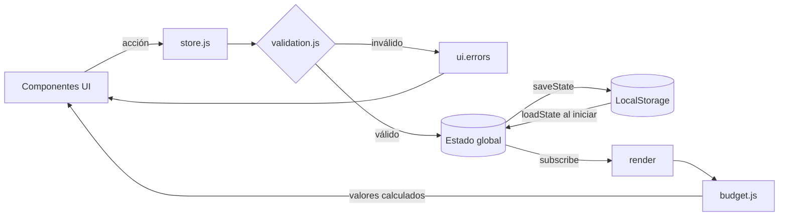

# Diseño Técnico: NomadPulse Travel Assistant

**Versión:** 1.2 (S3L2, Paso 1: armonización)
**Insumos:** `requirements.md`, `data-contract.json`, `wireframe.png`, `CLAUDE.md`

---

## 1. Decisiones de arquitectura

- **Tecnología:** SPA en HTML, CSS y JavaScript (módulos ES). Sin frameworks ni compilación.
- **Estado:** un único objeto global `state`: datos según `data-contract.json` + `ui` (no se guarda).
- **Persistencia:** solo LocalStorage. Sin red (REQ-022).
- **Flujo unidireccional:** UI → acción → validación → estado → guardado → render.
- **Derivados:** `totalDays`, `GlobalBudget` y `DailyFoodLimit` se calculan en cada render; no se guardan.

---

## 2. Estructura de módulos

```
src/
├── index.html
├── styles.css
├── main.js           # Arranque: loadState, subscribe(render), recordatorio
├── store.js          # Estado global, acciones y subscribe
├── storage.js        # loadState / saveState
├── validation.js     # Reglas de validación
├── budget.js         # Cálculos de presupuesto y comida
├── reminder.js       # Recordatorio diario y notificación
└── components/
    ├── App.js        # Shell + BottomNav
    ├── TripScreen.js
    ├── CategoriesScreen.js
    ├── HomeScreen.js
    ├── ExpenseForm.js
    ├── ExpenseList.js
    ├── ItineraryScreen.js
    └── ConfirmDialog.js
```

Los subcomponentes (`FoodTodayCard`, `DaySelector`, etc.) son funciones dentro del archivo de su pantalla.

---

## 3. Componentes de la interfaz (según `wireframe.png`)

| Pantalla | Componente | Subcomponentes |
|---|---|---|
| Todas | `App` | `BottomNav`, `CurrencyToggle` |
| 1. Viaje | `TripScreen` | `CurrencyPicker`, `FieldError`, `ConfirmDialog` |
| 2. Categorías | `CategoriesScreen` | `BudgetSummary`, `CategoryList`, `CategoryForm` |
| 3. Inicio | `HomeScreen` | `ReminderBanner`, `FoodTodayCard`, `OverLimitAlert`, `BudgetProgress` |
| 4. Registrar gasto | `ExpenseForm` | `ExpenseTypeToggle`, `CategoryPicker`, `FieldError` |
| 5. Lista de gastos | `ExpenseList` | `ExpenseFilter`, `ConfirmDialog` |
| 6. Itinerario | `ItineraryScreen` | `DaySelector`, `ItineraryList`, `ItineraryForm` |

**Notas de armonización con el wireframe** (lo que la imagen no muestra o simplifica):
- **Inicio:** el boceto muestra a la vez el disponible positivo (₡3 000) y la alerta de límite superado (−₡2 000) solo para ilustrar ambos estados. En la app, `OverLimitAlert` aparece únicamente si `availableToday < 0`. (REQ-007, REQ-031, REQ-039)
- **Viaje:** se agrega `CurrencyPicker` (₡ / $), que no aparece en el boceto. Solo se puede elegir al crear el viaje; al editar se muestra como solo lectura. (REQ-045, REQ-046) También se agrega el campo opcional "Tipo de cambio (₡ por $1)". (REQ-048)
- **Todas las pantallas:** `CurrencyToggle` es un botón en la parte superior (no aparece en el boceto) que activa o desactiva la vista convertida. Los formularios siguen pidiendo montos en la moneda del viaje. (REQ-047) Si el cambio de fechas se bloquea, la lista de registros afectados se muestra en esta misma pantalla. (REQ-025)
- **Registrar gasto:** con "Previo al viaje", la fecha debe ser anterior al inicio del viaje. (REQ-044)
- **Itinerario:** tocar una actividad la carga en `ItineraryForm` para editarla, igual que `ExpenseForm` con los gastos. (REQ-042)
- **Datos dañados:** si `loadState` falla, `App` muestra el error y un `ConfirmDialog` para empezar de cero; solo al confirmar se sobrescribe LocalStorage. (REQ-019)

---

## 4. Manejo de estado

| Dato | Dónde vive | Motivo |
|---|---|---|
| `trip`, `categories`, `expenses`, `itinerary` | Estado + LocalStorage (`nomadpulse.state`) | Datos del usuario. |
| Fecha del último recordatorio | LocalStorage (`nomadpulse.lastReminder`) | Recordatorio una vez al día. |
| `ui`: `currentScreen`, `selectedDay`, `expenseFilter`, `errors`, `pendingDelete`, `showConverted` | Solo estado | Estado de interfaz. |
| `totalDays`, `GlobalBudget`, `DailyFoodLimit` | Se calculan | Evitar datos desactualizados. |

**`store.js`:** `getState()`, `subscribe(fn)` y acciones. Cada acción: validar → modificar → `saveState()` → avisar a los suscriptores.

---

## 5. Funciones clave

| Módulo | Función | Qué hace | REQ |
|---|---|---|---|
| `budget.js` | `getToday()` | Fecha local `YYYY-MM-DD` (no UTC) | Glosario "Hoy" |
| | `getTotalDays(trip)` | (fin − inicio) + 1 | 001, 026 |
| | `isFoodCategory(category)` | Nombre igual a "Comida" sin distinguir mayúsculas ni espacios | 004, 041 |
| | `getFoodBudget(categories)` | Monto de la categoría Comida | 004 |
| | `getDailySpent(state, today)` | Suma gastos `on-trip` de Comida de hoy | 035, 036 |
| | **`calculateDailyFoodLimit(state, today)`** | Devuelve `{ limit, dailySpent, availableToday, isOverLimit }` con `availableToday = (foodBudget / totalDays) − dailySpent` | 004, 007, 031, 034–037 |
| | `getGlobalBudget(state)` | `{ total, spent, available, percentUsed }` | 005, 006, 030 |
| | `getUnassignedAmount(state)` | Total − suma de categorías | 003, 027 |
| | `formatMoney(n, currency)` | Redondea a 2 decimales solo al mostrar y antepone ₡ o $ | 037, 045 |
| | `toDisplayMoney(n, trip, showConverted)` | Si `showConverted`, convierte solo para mostrar (₡ → $: ÷ `exchangeRate`; $ → ₡: × `exchangeRate`) y llama a `formatMoney` | 047 |
| `validation.js` | **`validateAmount(value)`** | Rechaza montos ≤ 0 o no numéricos | 011 |
| | `validateRequired(value)` | Rechaza campos vacíos | 012, 015 |
| | `validateTrip(data)` | Campos (incluida moneda) + fin ≥ inicio | 001, 013, 024 |
| | `validateCategory(data, state)` | Nombre único sin distinguir mayúsculas + no exceder total | 002, 003 |
| | `validateExpense(data, state)` | Monto, categoría y fecha: `pre-trip` antes del inicio, `on-trip` en rango | 011–015, 044 |
| | `validateItineraryItem(data, trip)` | Descripción + fecha en rango | 010, 042 |
| | `findRecordsOutsideRange(state, start, end)` | Lista gastos/actividades fuera del nuevo rango y gastos previos que ya no quedan antes del inicio | 025, 044 |
| `ItineraryScreen.js` | `sortDayItems(items)` | Con hora primero (por hora); sin hora al final, en orden de ingreso | 010, 042 |
| `storage.js` | `saveState(state)` | Guarda tras cada cambio | 017 |
| | `loadState()` | Carga al iniciar; si está dañado, avisa y no sobrescribe | 018, 019 |
| `reminder.js` | `shouldShowReminder(today)` | Primera apertura del día dentro del viaje | 008 |
| | `scheduleMorningNotification()` | Notificación a las 08:00 solo con la app abierta y permiso concedido. Sin Service Worker. | 009 |

**Reglas de acciones en `store.js`:**
- `addExpense` / `updateExpense` nunca revisan el presupuesto: exceder solo alerta. (REQ-023)
- `deleteCategory` se bloquea si la categoría tiene gastos. (REQ-016)
- `updateTrip` usa `findRecordsOutsideRange` y `getUnassignedAmount`, y nunca cambia `currency`. (REQ-025, REQ-027, REQ-046)
- `deleteTrip` borra en cascada tras confirmar. (REQ-028)
- `deleteExpense` / `deleteItineraryItem` piden confirmación. (REQ-029, REQ-043)

---

## 6. Flujo de datos



---

## 7. Mapeo de requerimientos

| REQ | Se cumple en |
|---|---|
| 001 | `TripScreen`, `CurrencyPicker`, `validateTrip`, `getTotalDays` |
| 002, 003 | `CategoriesScreen`, `validateCategory`, `getUnassignedAmount` |
| 004 | `calculateDailyFoodLimit`, `getFoodBudget`, `isFoodCategory` |
| 005, 006 | `ExpenseForm`, `addExpense`, `getGlobalBudget` |
| 007, 031 | `OverLimitAlert` según `isOverLimit` |
| 008 | `ReminderBanner`, `shouldShowReminder` |
| 009 | `scheduleMorningNotification` |
| 010, 042, 043 | `ItineraryScreen`, `validateItineraryItem`, `sortDayItems`, `ConfirmDialog` |
| 011 | **`validateAmount`** |
| 012, 015 | `validateRequired` |
| 013, 024 | `validateTrip` |
| 014 | `validateExpense` |
| 016 | `deleteCategory` |
| 017 | `saveState` |
| 018 | `loadState` |
| 019 | `loadState`, `App` + `ConfirmDialog` (empezar de cero) |
| 020, 021 | `ItineraryScreen`: sin sugerencias ni recomendaciones |
| 022 | `storage.js`: sin llamadas de red |
| 023 | `addExpense` / `updateExpense`: sin bloqueo por presupuesto |
| 025 | `TripScreen`, `findRecordsOutsideRange` |
| 026 | `getTotalDays` (se recalcula en cada render) |
| 027 | `updateTrip`, `getUnassignedAmount` |
| 028 | `deleteTrip`, `ConfirmDialog` |
| 029, 030 | `ExpenseList`, `ConfirmDialog`, `deleteExpense`, `getGlobalBudget` |
| 032, 033 | `updateExpense`, `validateExpense` |
| 034 a 037 | **`calculateDailyFoodLimit`**, `getDailySpent`, `formatMoney` |
| 038 a 041 | `FoodTodayCard`, `isFoodCategory` (041) |
| 044 | `validateExpense`, `findRecordsOutsideRange` |
| 045 | `CurrencyPicker`, `formatMoney` |
| 046 | `CurrencyPicker` (solo lectura al editar), `updateTrip` |
| 047 | `CurrencyToggle`, `ui.showConverted`, `toDisplayMoney` |
| 048 | `TripScreen` (campo tipo de cambio), `validateAmount`, `updateTrip` |

---

## 8. Historial de auditoría

| Versión | Cambio |
|---|---|
| 1.0 (Paso 2) | Primera propuesta de la IA. |
| 1.1 (Paso 3, Ronda 1) | Poda: se eliminan `router.js`, `eventBus.js` y `models/` (6 archivos). |
| 1.1 (Paso 3, Ronda 2) | Mapeo: funciones explícitas para reglas críticas (`calculateDailyFoodLimit`, `validateAmount`) y para REQ-009, REQ-023 y REQ-025; mapeo por REQ. |
| 1.2 (S3L2, Paso 1) | Armonización: moneda por viaje, fija tras crear el viaje (`CurrencyPicker`, `formatMoney`, REQ-045, REQ-046); vista convertida con tipo de cambio manual (`CurrencyToggle`, `toDisplayMoney`, REQ-047, REQ-048); fecha de gastos previos (REQ-044); `isFoodCategory`, `getToday` y `sortDayItems`; notas sobre lo que el wireframe no muestra; UI de REQ-019 y REQ-025. |
